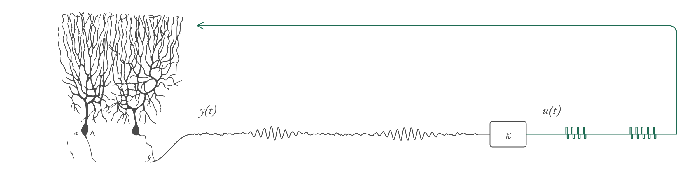
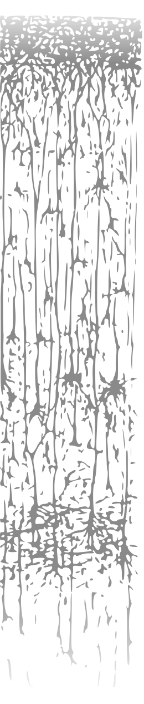

<picture>
  <source media="(prefers-color-scheme: dark)" srcset="assets/banner-dark.png">
  
</picture>

### Garrett W. Thrash

M.D. Candidate (c/o 2027) • Incoming Ph.D. Student, Neuroengineering (2027) 
University of Alabama at Birmingham Heersink School of Medicine

<picture>
  <source media="(prefers-color-scheme: dark)" srcset="assets/column-dark.png">
  
</picture>

In Dr. Harrison Walker's lab I work on decoding subthalamic nucleus recordings, including evoked resonant neural activity (ERNA), for adaptive deep brain stimulation.

**Toolboxes**

- [clean_dbs](https://github.com/gthrash54/clean_dbs): Walker lab toolbox for loading and cleaning intraoperative DBS recordings. Written with AI coding assistance.
- [preprocess_dbs](https://github.com/gthrash54/preprocess_dbs): Walker lab toolbox for preprocessing cleaned intraoperative DBS recordings (LFP and ERNA). Written with AI coding assistance.

**Publications**

14 peer-reviewed papers in neuromodulation, neurosurgical outcomes, and equitable access to neurological care. [Full list](https://garrettthrash.com/publications/)

**Writing** and **Commonplace**: coming soon on [garrettthrash.com](https://garrettthrash.com).

[garrettthrash.com](https://garrettthrash.com) • [Google Scholar](https://scholar.google.com/citations?user=FJ4ulF4AAAAJ) • [ORCID](https://orcid.org/0009-0008-1061-8679) • [LinkedIn](https://www.linkedin.com/in/garrett-thrash-311709430/) • gthrash@uab.edu
